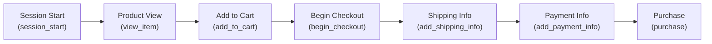

# E-Commerce Product Funnel & Revenue Conversion Intelligence Platform

An end-to-end analytics platform designed to analyze user behavior, conversion funnels, drop-off rates, and revenue drivers using Google Analytics 4 (GA4) e-commerce event streams.

---

## 📁 Project Architecture

```
GA4-Ecommerce-Analytics/
│
├── data/
│   ├── raw/
│   │   └── ga4_raw_data.csv        # Raw GA4 event export dataset
│   │
│   └── processed/                  # Cleaned, standardized, and aggregated datasets
│
├── notebooks/
│   └── 01_data_cleaning.ipynb      # Ingestion, quality checks, timestamp conversion, and cleaning
│
├── sql/                            # Analytical SQL scripts (funnel metrics, cohort retention, attribution)
│
├── reports/                        # Visualizations, executive summaries, and KPI reporting decks
│
└── README.md                       # Project documentation and guidelines
```

---

## 📊 Dataset Overview

The raw event log (`data/raw/ga4_raw_data.csv`) captures user interactions across standard Google Analytics 4 e-commerce stages:

| Column | Description |
| :--- | :--- |
| `event_date` | Date of the event in `YYYYMMDD` integer format |
| `formatted_date` | Date in `YYYY-MM-DD` ISO format |
| `event_timestamp` | Event time in microseconds (UNIX epoch) |
| `event_name` | GA4 event name (e.g. `session_start`, `view_item`, `add_to_cart`, `purchase`) |
| `user_pseudo_id` | Pseudonymous identifier assigned to a unique user/client |
| `device_category` | Device used (`desktop`, `mobile`, `tablet`) |
| `traffic_source` | Source of traffic acquisition |
| `traffic_medium` | Medium of traffic acquisition |
| `session_id` | Identifier for each unique browsing session |
| `engagement_time_msec` | User engagement time in milliseconds |

### E-Commerce Funnel Flow



---

## 🚀 Getting Started

### 1. Prerequisites
- Python 3.9+
- Jupyter Notebook / JupyterLab
- Pandas, NumPy, Matplotlib, Seaborn

```bash
pip install pandas numpy matplotlib seaborn jupyter
```

### 2. Data Cleaning & Preparation
Open and run the initial data cleaning notebook:
```bash
jupyter notebook notebooks/01_data_cleaning.ipynb
```

This will preprocess raw timestamps, validate event streams, address missing fields, and write the cleaned dataset into `data/processed/`.

### 3. Analytics & Reporting
- Custom SQL queries for BigQuery / DuckDB / PostgreSQL are organized under [`sql/`](sql/).
- Final analysis reports, conversion intelligence insights, and charts are stored under [`reports/`](reports/).
